<p align="center"></p>

<h1 align="center">Essais</h1>

<p align="center">A notebook for your Mac.<br>One notebook, one day after another.</p>

<p align="center"><a href="https://andrespaladino.github.io/essais/">Website</a> · <a href="../../releases/latest">Download</a> · <a href="#build">Build from source</a></p>

## Why

There are no folders to set up, no templates to choose and no entries to name. You open it and write.

Each day is a plain Markdown file in `~/Documents/Essais`, or a folder you choose, so any editor can open your writing. There's no account, server or database. Essais is written in Swift with AppKit.

## Install

Download the `.dmg` from [Releases](../../releases/latest) and drag Essais to Applications. It updates itself: it checks once a day and asks before installing.

Essais isn't notarized, so macOS blocks it the first time. Open System Settings, go to Privacy & Security and click Open Anyway.

Requires macOS 26 or later.

## Build

Needs the Xcode Command Line Tools.

```sh
scripts/build.sh --install   # build and copy to /Applications
scripts/dist.sh              # universal .dmg in dist/
```

## License

MIT
